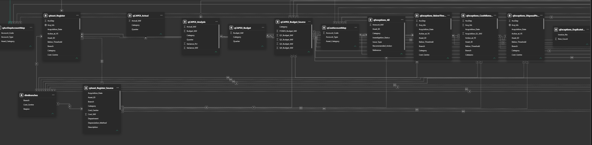
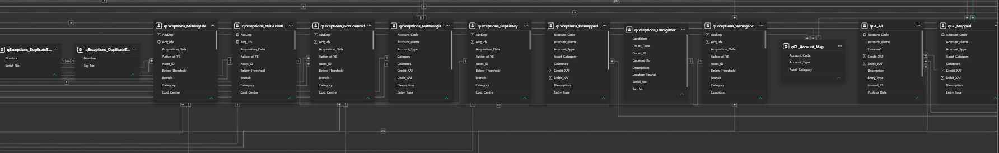
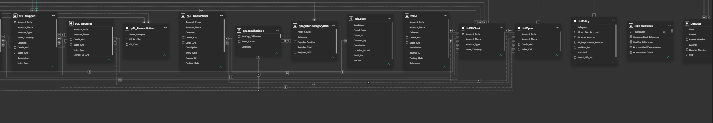

# Fixed Asset Control

Power BI fixed-asset control model for a fictional **Demo Bank Cameroun**. The project covers register depreciation, GL reconciliation, exceptions, physical verification, and CAPEX analysis.

All data is fictional and created for demonstration and interview purposes. It does not come from a real bank or client.

## Project Files

- [Power BI report](Fixed%20Assets%20Register.pbix): report and semantic model
- [Source workbook](FA_Control_Model_backup.xlsx): fictional source data used to build the model

## Model View

The Power BI model is documented across three screenshots:







Core model areas:

- `qAsset_Register`: asset register, depreciation, NBV, and disposal calculations
- `qGL_Mapped`: GL entries mapped to asset category and account type
- `qGL_Reconciliation`: category-level GL cost and accumulated depreciation
- `qRegister_CategoryBalances`: active-register balances by category
- `qReconciliation 1`: register-versus-GL reconciliation and status
- `qExceptions_All`: consolidated exception log
- `qPhysical_Count_Source`: physical verification source
- `qExceptions_NotCounted`: active assets missing from the physical count
- `qCAPEX_Analysis`: CAPEX budget, actual, and variance
- `DimDate`: date dimension
- `dimBranches`: branch dimension
- `DAX Measures`: report measures and dynamic commentary

## Source Workbook

The source workbook contains:

- `Asset_Register`: 206 assets across eight categories, acquired from 2018 to 2025, including 11 disposals
- `GL_Opening` and `GL_Transactions`: opening balances and 282 balanced FY2025 journal lines
- `CAPEX_Budget`: quarterly budget by category; actuals are derived from the asset register
- `Physical_Count`: 192 physical-count results from January 2026
- `Assumptions`: capitalisation threshold, useful lives, and depreciation conventions
- `GL_Chart`: chart of accounts and category mappings
- `BranchesLookup`: branch lookup values

The workbook is the build input. A separate answer-key workbook is used only to check the completed analysis and is not the source of the model.

## Analysis Workflow

1. Calculate depreciation per asset and per month, then calculate NBV at 31 December 2025.
2. Reconcile register cost and accumulated depreciation to the GL by category.
3. Explain each difference through the exception and physical-verification analysis.
4. Build the dashboard and compare the results with the separate answer key.

## Reconciliation Rules

- Cost and accumulated depreciation differences are calculated as GL minus register.
- Depreciation starts in the month of acquisition and stops in the month before disposal.
- Differences within plus or minus 10 XAF are classified as `Reconciled` in the current model; the source exercise notes that differences below 150 XAF are rounding differences.
- Larger differences are classified as `Investigate`.
- The duplicate register row `FA-0206` is excluded from physical `Not Counted` KPIs but remains in the register for control analysis.

Register and GL differences can have different causes. A category mismatch can move cost between categories without changing the overall total, while missing postings, duplicates, disposals, or depreciation errors affect one side of the reconciliation.

## Validated Figures

The completed model currently produces the following validation results:

| Metric | Value |
| --- | ---: |
| Register rows | 206 |
| Distinct assets after duplicate adjustment | 205 |
| Active assets | 196 |
| Disposed assets | 10 |
| Register cost | 2,903,712,000 XAF |
| Register accumulated depreciation | 868,443,422 XAF |
| Register NBV | 2,035,268,577 XAF |
| Reconciliation categories | 8 |
| Categories reconciled | 5 |
| Net cost difference | 5,120,000 XAF |
| Absolute cost difference | 12,540,000 XAF |
| Accumulated depreciation difference | 3,026,664 XAF |
| Exception rows | 36 |
| Open exceptions | 36 |
| Physical count rows | 192 |
| Not counted | 8 |
| Counted | 188 |
| Other branch | 6 |
| Unregistered items | 5 |
| Damaged items | 4 |
| CAPEX budget | 377,300,000 XAF |
| CAPEX actual | 280,232,000 XAF |
| CAPEX variance | -97,068,000 XAF (-25.7%) |

## Key Measures

Measures are stored in the `DAX Measures` table, including:

- `[Register Cost]`
- `[Register AccDep]`
- `[Register NBV]`
- `[Active Asset Count]`
- `[Cost Difference]`
- `[Absolute Cost Difference]`
- `[AccDep Difference]`
- `[Exception Count]`
- `[Open Exceptions]`
- `[Exception Amount]`
- `[Exception Amount at Stake]`
- `[Key Findings Text]`
- `[CAPEX Commentary]`

## Report Pages

1. Overview
2. Register and Depreciation
3. Reconciliation
4. Exceptions
5. Physical Verification
6. CAPEX vs Budget

The report cutoff is **31 December 2025**.

These figures should be checked against the separate answer-key workbook after the source analysis is complete.

## Model Screenshot Workflow

1. Open the PBIX file in Power BI Desktop.
2. Select **Model view**.
3. Arrange the core tables so their relationships are readable.
4. Capture the view with `Windows + Shift + S`.
5. Save the screenshots as `docs/model-1.png`, `docs/model-2.png`, and `docs/model-3.png`.
6. Commit the README and images:

```powershell
git add README.md docs/model-1.png docs/model-2.png docs/model-3.png
git commit -m "Document Power BI model"
git push origin main
```
